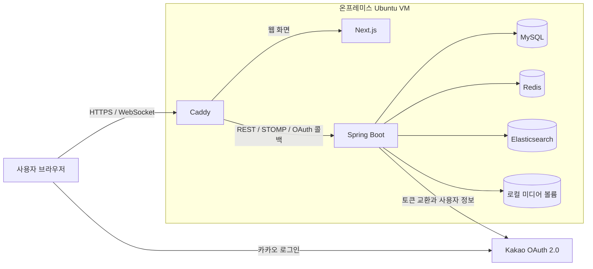

# Balearn

**Balance + Learn** · 스터디 모임의 일정, 미션, 자료, 대화를 한곳에서 관리하는 학습 협업 서비스

[Balearn 바로 가기](https://hmwg.balearn.o-r.kr:9443/) · [프런트엔드](https://github.com/Jibsa-team/balearn-fe) · [백엔드](https://github.com/Jibsa-team/balearn-be)

## 📅 프로젝트 개요

스터디 일정, 다음 모임까지 할 일, 공유 자료가 여러 채널에 흩어지면 팀원마다 확인해야 할 곳이 늘어납니다. Balearn에서는 모임을 만들고 팀원을 초대하면, 그 모임의 대시보드에서 목표와 일정을 확인하고 자료와 메시지를 공유할 수 있습니다. 오늘의 미션을 완료하면 점수가 반영돼 참여 기록을 확인할 수 있습니다.

- **프로젝트 시작** · 2024년 12월 26일
- **유지보수 재개** · 2026년, 온프레미스 운영 환경 구축

### 팀원 소개

| 황민우 | 이재인 |
| :---: | :---: |
|  |  |
| [@HMWG](https://github.com/HMWG) | [@JaeIn1](https://github.com/JaeIn1) |

## 💡 서비스 소개

### 주요 기능

| 기능 | 할 수 있는 일 |
| --- | --- |
| 로그인·모임 | 카카오 계정으로 로그인하고 모임을 만들거나 초대 코드로 가입합니다. |
| 대시보드 | 모임 목표, 공지, 멤버, 주간 일정을 확인합니다. |
| 캘린더 | 주간·월간 일정에서 모임 일정을 등록하고 수정하거나 삭제합니다. |
| 미션·리더보드 | 오늘의 미션을 완료하고 개인 점수와 모임 순위를 확인합니다. |
| 자료 | 학습 자료를 올리고 목록과 최근 열어본 파일을 확인합니다. 자료 다운로드에는 해당 모임의 멤버 권한이 필요합니다. |
| 채팅 | 모임 안에서 실시간으로 대화하고 이전 메시지를 확인합니다. |
| 모임 설정 | 권한에 따라 모임 프로필, 멤버 권한, 초대, 공지를 관리합니다. |

### 이용 흐름

1. 카카오로 로그인하고 사이드바에서 모임을 만들거나 초대 코드로 가입합니다.
2. 대시보드에서 목표와 주간 일정을 확인하고, 캘린더에 스터디 일정을 등록합니다.
3. 자료와 채팅으로 팀원과 학습 내용을 공유합니다.
4. 오늘의 미션을 완료하고 리더보드에서 점수와 순위를 확인합니다.

## ⚙️ 기술 스택

| 영역 | 구성 |
| --- | --- |
| 프런트엔드 | Next.js App Router, React, TypeScript, Tailwind CSS, TanStack Query, Zustand, PWA |
| 백엔드 | Kotlin, Java 17, Spring Boot, Spring Security, Spring Data JPA, Gradle |
| 인증·실시간 통신 | Kakao OAuth 2.0, JWT, SockJS/STOMP |
| 데이터 | MySQL, Redis, Elasticsearch, 로컬 영구 볼륨 |
| 운영 인프라 | Ubuntu VM, Docker Compose, Caddy, Let's Encrypt |

## 📂 ERD 및 시스템 아키텍처

운영 환경은 한 HTTPS 주소로 웹 화면, REST API, 실시간 채팅을 제공합니다. 카카오는 사용자 인증을 담당하고, Balearn 백엔드는 사용자 세션과 모임별 권한을 처리합니다.

- MySQL은 모임, 일정, 미션, 자료 메타데이터를 저장합니다. 채팅 이력은 Redis와 Elasticsearch를 사용합니다.
- 운영 미디어는 로컬 볼륨에 저장합니다. 배포 환경에 따라 Google Cloud Storage를 선택할 수 있습니다.
- 로컬 기능 검증은 별도 데이터와 Keycloak 테스트 계정을 사용합니다. 공개 운영 사이트는 카카오 로그인으로 운영합니다.
- 초기 데이터 모델과 배포 구성은 기존 설계 자료에서 확인할 수 있습니다. [초기 ERD](https://www.erdcloud.com/d/WWZCPQbfBn6CMjvAz) · [초기 프로젝트 소개 및 아키텍처](https://github.com/Jibsa-team/.github/blob/548ad9a1fcb434b84bbc7a2de81822969dd4b692/profile/README.md)

## 🖼 주요 화면

아래는 초기 버전에서 촬영한 대표 화면입니다. 현재 로그인 화면은 [운영 사이트](https://hmwg.balearn.o-r.kr:9443/)에서 볼 수 있습니다.

| 대시보드 | 캘린더 |
| --- | --- |
|  |  |

| 학습 자료 | 리더보드 |
| --- | --- |
|  |  |

## 📍 저장소와 컨벤션

| 저장소 | 담당 영역 |
| --- | --- |
| [`balearn-fe`](https://github.com/Jibsa-team/balearn-fe) | 웹 화면, 브라우저 상태, REST·STOMP 클라이언트 |
| [`balearn-be`](https://github.com/Jibsa-team/balearn-be) | REST API, 인증과 권한, 도메인 로직, 데이터와 파일 저장 |

앱 저장소의 기존 `develop`은 이전 개발 이력을 보관하는 기준입니다. 유지보수 작업은 별도 개발 브랜치에서 진행합니다. API 계약을 변경할 때는 백엔드 DTO와 권한 규칙, 프런트엔드 타입과 호출부를 함께 확인합니다.

커밋은 팀에서 사용해 온 `<유형> : <설명>` 형식을 따릅니다.

| 유형 | 용도 |
| --- | --- |
| `feat`, `fix` | 기능 추가, 오류 수정 |
| `docs`, `test` | 문서, 테스트 변경 |
| `refactor`, `style` | 동작을 유지하는 코드 구조 개선, 서식 정리 |
| `chore`, `init` | 빌드·개발 설정, 초기 구성 |
| `add`, `rename` | 정적 자원 추가, 파일·폴더 이름 변경 |
